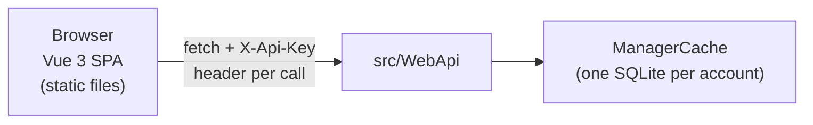

# Sample/WebUI — Vue 3 SPA over the WebApi

This is a **sample consumer** of the WebApi, in the same spirit as `Sample/DemoProject`
(a WinForms app): a browser front-end proving the API is complete enough to run
someone's finances from. It is a product only as far as it stays useful to its owner.



## Ground rules

- **The WebUi is a plain HTTP client.** It never touches SQLite, never references
  the `Simple.Finance` library, never references the WebApi project. Everything
  goes through the REST endpoints — that is the point of the sample: it documents
  what the API surface can really do.

### API instructions

Any instruction about the API (endpoint shapes, parameters, statuses, traps)
comes from, in order:

1. **The repository** — the WebApi source under `src/WebApi/` is the truth.
2. **The live swagger** — if the WebApi is running, `http://<host>:<port>/swagger`
   documents the API as deployed. Use it when working against a remote server.

For how to *consume* the API properly (money rules, three dates, traps), read
`src/WebApi/AGENTS.md` first — it is written for exactly this kind of client.

- **The Key lives in the browser** (`localStorage`), one entry per saved account,
  with a switcher. This is by design: the Key *is* the whole credential and the
   API is stateless-multi-session — any number of clients can hold it at once.
  Consequence, accepted on purpose: JavaScript on the page can read it, so the
  SPA carries **zero third-party runtime code** (see `Packages.md`) to keep the
  XSS surface as small as the attack surface can be in a browser.
- **Read `Packages.md` before adding any npm package.** It is a governance
  contract, not a wish list.
- **English everywhere**, like the rest of the repository.

## Project layout (target)

```
Sample/WebUI/
├── Architecture.md        # this file — how the app is put together
├── Packages.md            # npm governance: the golden rule, checklists, curated list
├── README.md              # how to run it, day-to-day instructions
├── ToDo.md              # implementation plan — milestones, in order
├── package.json           # only packages from the Packages.md curated list
├── vite.config.ts         # dev proxy — where /api forwards in dev is the developer's choice
├── index.html
└── src/
    ├── main.ts            # mount + router
    ├── api/
    │   ├── client.ts      # fetch wrapper: X-Api-Key header, error shaping, 401 handling
    │   └── types.ts       # DTO mirrors of the WebApi request/response shapes
    ├── styles/
    │   └── themes.ts       # theme registry (satisfies Record<string, Theme>) + applyTheme
    ├── components/        # hand-written, no UI kit — table, form fields, money display
    └── views/             # one file per screen: Login, Wallets, Transactions, ...
```

## Application state

All client-side, all trivial on purpose:

| Concern | Where | Notes |
|---|---|---|
| Saved servers | `localStorage["webui.servers"]` | `[{ label, baseUrl }]` — user-configured; nothing is baked in |
| Accounts per server | `localStorage["webui.accounts"]` | `[{ serverLabel, label, key }]`; a Key opens exactly one account on exactly one server |
| Active server + account | `localStorage["webui.active"]` | `{ serverLabel, key }`; switching re-navigates to the dashboard |
| Server data | component-local | no store, no pinia — each view fetches what it shows; the app is small enough that a store would be ceremony |

### Connecting to a server

The UI assists the connection instead of assuming a target:

1. **Add server** — user gives a base URL (e.g. `http://localhost:5080`). The UI
   validates with `GET /api/hello` (anonymous) and reports reachability/version
   before saving.
2. **Then an account** — paste an existing Key or create one (`POST /api/account`,
   anonymous on that server). Account creation **asks for the primary
   currency**, offering the browser's locale currency as the suggested default
   (`Intl` exposes it; the list comes from the ISO currency codes, same source
   the library uses). It is a convenience default, not a decision made for the
   user — the choice is shown and changeable before the wallet is created.
   Validated with `GET /api/account/database`.
3. Failed connection attempts surface the reason (unreachable, not-a-WebApi,
   invalid Key) — the user should never guess why a server does not respond.

### Money input (hand-written, no library)

Money is the hard problem of web forms — float binary cannot represent
decimal (`0.1 + 0.2 !== 0.3`). The WebUi's rules:

- **Integer cents are the only internal representation** of money in the
  WebUi. Parsing (`string` → cents) happens in the money component;
  cents → JSON number happens only at the API boundary. No float ever lives
  in a form's state.
- Display uses `Intl.NumberFormat` with the wallet's currency — no formatting
  library.
- The component supports **bank-style typing**: digits typed walk left as
  they are entered, so `1500` reads `15,00` and the decimal separator is
  never typed (`inputmode="decimal"` for the phone keypad). This is a mode
  the user can toggle; classic free-typed input stays available.
- The API owns every calculation. The WebUi never sums, converts or rounds
  money except for running totals it displays — and those sum cents.

Every API call goes to the **active server's** `baseUrl`; the client layer
prepends it and attaches the `X-Api-Key` header. The dev proxy (`vite.config.ts`)
is only a dev convenience — the production app always calls the configured
server directly (CORS on the WebApi is open).

## Theming

One mechanic only, one entity: a **Theme** — a named set of CSS custom
properties. There is no separate light/dark axis: a dark theme is just a
theme with dark values.

Its primary job is **account identity**: the connected account's theme tints
the UI subtly so "Company 1 is blue, Company 2 is green" becomes muscle
memory and the user stops entering expenses in the wrong account. For the
single-account user it is simply pleasing to the eye — same mechanic, no
second system.

### Where the theme lives

| State | Where | Notes |
|---|---|---|
| The account's theme | `AccountPreference` on the server: preference name `theme`, value = a theme name | Travels with the account to any browser; read with `GET /api/account/preferences`, written with `PUT /api/account/preferences/{name}` — both already exist, **no API change** |
| Active in the session | CSS custom properties on `<html>`, set by `applyTheme(name)` on connect and on switch | A theme is data in `themes.ts`; applying it is setting vars |
| Login-screen preview | `localStorage["webui.theme.<serverLabel>.<accountLabel>"]` | Cache of the last-seen theme so account cards can be tinted **before** connecting — there is no Key to read preferences with at that point. Server stays the truth; cache is only a preview. A brand-new account on a new browser shows neutral until first connect |

### Subtle by design

The theme's `accent` (and its soft background derivative) is the identity
color. It may tint: top bar, input focus ring, selected row highlight, the
account's card on the selection screen. It must **not** tint: body text,
general background, semantic colors (`success`/`warning`/`error` stay their
own tokens on every theme). The effect is association, not decoration.

### Structure

- `src/styles/themes.ts` — the registry: `satisfies Record<string, Theme>`;
  a new theme is a new object, and `tsc` forces every token to exist (no
  silent fallback — a missing token fails the build).
- Tokens: `--fg`, `--muted`, `--border`, `--surface`, `--accent`,
  `--accent-soft`, `--success`, `--warning`, `--error`, `--c1..c4` (chart
  series). Components only ever consume `var(--…)`.
- Initial ship: `slate` (neutral default), `azure`, `emerald`, `violet`,
  `amber`, `rose`.
- No theming-related packages; CSS custom properties are the mechanism.

## API integration details that matter

- Header: `X-Api-Key: <guid>` on every call except `POST /api/account` (anonymous,
  creates an account and returns the Key **once** — the UI must treat it as a
  secret shown exactly once, with a copy button and a "store it" warning).
- Dev proxy: Vite may forward `/api` to a server under development — a dev
  convenience only; the app itself always talks to the configured `baseUrl`.
- The API validates by throwing; the UI must surface the `400` `ProblemDetails`
  message as a readable error — it is the domain talking (category forces sign,
  `categoryId != 0`, `dueValue != 0`, wallet-currency mismatch, ...). Never
  "work around" a 400: they are the money rules, documented in `src/WebApi/AGENTS.md`.
- Dates on the wire are explicit UTC; the UI renders in the browser's locale
  but never re-sends what it parsed — it sends back what it received.
- Enums travel as names (`"Paid"`, `"WalletTransfer"`, ...) — display them as-is.

### The phone is the primary target

The UI must be good on a phone first, then tablets — the PC is a special case
of tablet, designed last. What this means in practice:

- Layouts and touch targets are designed at phone width; larger screens get
  more, not different, affordances.
- "Table" is a desktop word: on a phone, dense grids collapse into cards or
  rows designed for a thumb. A screen that only works as a grid is not done.
- Every screen's smoke includes using it at phone width (dev tools device
  mode is enough).

## Screens (initial scope)

1. **Connect** — add a server (base URL, validated with `GET /api/hello`), then
   paste an existing Key or create an account (`POST /api/account`). Validated
   with `GET /api/account/database`. Account cards show each account's theme
   accent from the local preview cache (see *Theming*).
2. **Wallets** — list with balances; `GET /api/wallets`, one
   `GET /api/wallets/{id}/balance` per wallet (balances are per-wallet and never
   cross currencies — the screen must not sum them; if it ever wants a "total",
   group by currency and label it, never a single number).
3. **Transactions** — paginated table (`GET /api/transactions` with
   `start/end/kind/order/limit`), create form, transfer form, import OFX/MT940
   (parse-only endpoint — the UI posts back what it parsed, nothing is written
   by the import itself).

Beyond that: categories, persons, scenarios, invoices, change log — same
patterns, added screen by screen.

## What "done" means for a screen

- Fetches work against a live API (smoke: `dotnet run --project src/WebApi`).
- Errors from the API are shown with the server's message, not swallowed.
- Empty states are designed, not accidental.
- The build passes: `npm run build` with zero new packages outside `Packages.md`.
